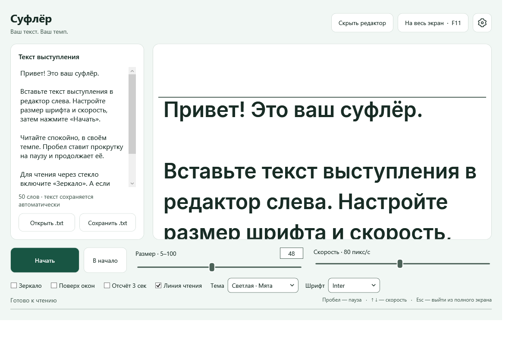
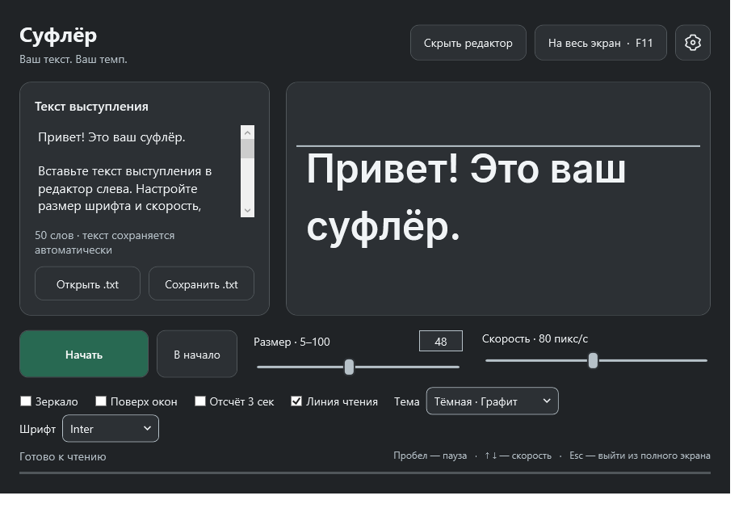
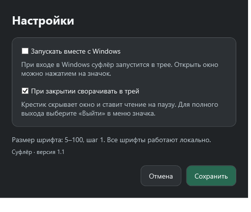

<div align="center">


# Суфлёр

**Ваш текст. Ваш темп.**

Простой суфлёр для Windows. Вставьте текст, настройте размер и скорость — и читайте.

[](https://github.com/imolchanof/sufler/releases/latest/download/Sufler.exe)
[](https://github.com/imolchanof/sufler/releases/latest)

[](https://github.com/imolchanof/sufler/actions/workflows/windows.yml)


[](LICENSE)

[Скачать .exe](https://github.com/imolchanof/sufler/releases/latest/download/Sufler.exe) · [Все релизы](https://github.com/imolchanof/sufler/releases) · [Сообщить об ошибке](https://github.com/imolchanof/sufler/issues)

</div>



## Начать за минуту

1. [Скачайте Sufler.exe](https://github.com/imolchanof/sufler/releases/latest/download/Sufler.exe) и положите в удобную папку. Установка не нужна.
2. Вставьте текст слева или откройте файл `.txt`.
3. Выберите размер шрифта и скорость. Нажмите **«Начать»**.

Размер можно ввести вручную в поле **«Размер · 5–100»**: например, `5`, затем Enter.

Приложение предназначено для Windows 10 и 11 с .NET Framework 4.x. Камера, микрофон и интернет для работы не нужны. Записи видео нет.

## Что умеет

| Возможность | Как работает |
|---|---|
| Размер текста | **От 5 до 100**, шаг 1. Ползунок и ввод числом. |
| Скорость | От 5 до 160 пикселей в секунду. Меняется во время чтения. |
| Пять шрифтов | **Inter**, Segoe UI, Arial, Georgia, Verdana. Все загружаются локально. |
| Пауза и повтор | Пробел останавливает и продолжает чтение. «В начало» возвращает к началу текста. |
| Полный экран | F11. Редактор также можно скрыть отдельно. |
| Зеркало | Горизонтальное отражение текста для стекла суфлёра. |
| Отсчёт | Три секунды перед стартом; можно отключить. |
| Линия чтения | Помогает держать взгляд на нужном уровне. |
| Поверх окон | Суфлёр остаётся видимым при работе с другими приложениями. |
| Четыре темы | Мята, Песок, Графит, Ночь — в стиле [Done’r](https://github.com/imolchanof/doner). |
| Трей | Открыть окно, начать или остановить чтение, перейти к настройкам, выйти. |
| Автозапуск | Включается в настройках. При входе в Windows приложение запускается в трее. |
| Автосохранение | Текст, выбранный шрифт и настройки сохраняются между запусками. |
| Работа с файлами | Открытие и сохранение `.txt`; чтение UTF-8, UTF-16 с BOM и Windows-1251. |

В конце текста прокрутка останавливается. Колесом мыши над суфлёром можно изменить позицию чтения.

## Настройки и трей

**Шестерёнка справа сверху** открывает настройки. Там можно включить автозапуск и выбрать, что делает крестик: завершает приложение или скрывает его в трей.

Левый щелчок по значку в трее открывает окно, правый — меню. При сворачивании в трей чтение ставится на паузу. Для полного выхода выберите **«Выйти»** в меню значка. Windows может поместить его в меню скрытых значков.

Повторный запуск открывает уже работающий экземпляр.

<details>
<summary><strong>Тёмная тема и окно настроек</strong></summary>





</details>

## Горячие клавиши

| Клавиши | Действие |
|---|---|
| Пробел | Начать / пауза / продолжить, когда фокус вне текстовых полей |
| Ctrl+Enter | Начать / пауза, в том числе из редактора |
| ↑ / ↓ | Быстрее / медленнее, вне текстовых полей |
| Home | В начало, вне текстовых полей |
| Page Up / Page Down | Перемотка, вне текстовых полей |
| F11 | Включить / выключить полный экран |
| Esc | Выйти из полного экрана; в обычном окне — пауза |
| Ctrl+O / Ctrl+S | Открыть / сохранить `.txt` |

## Где хранятся данные

Текст и настройки находятся в `%LOCALAPPDATA%\Sufler\session.xml`. Inter и его лицензия распаковываются в подпапку `Fonts` там же. Приложение не устанавливает шрифты в Windows и не обращается к Google Fonts.

Для переноса данных закройте суфлёр через меню трея и скопируйте папку `%LOCALAPPDATA%\Sufler`. Отдельные выступления можно сохранять кнопкой **«Сохранить .txt»**.

Автозапуск использует запись текущего пользователя `HKCU\Software\Microsoft\Windows\CurrentVersion\Run\Sufler`. Перед включением положите `.exe` в постоянную папку.

## Сборка из исходников

Нужна Windows с .NET Framework 4.x и встроенным компилятором C#. Установка .NET SDK и загрузка NuGet-пакетов не требуются.

```powershell
powershell -ExecutionPolicy Bypass -File .\src\build.ps1
```

Результат: `src\build\Sufler.exe`. Все ресурсы, включая Inter и его лицензию, встроены в один `.exe`.

Проверки:

```powershell
$test = Start-Process .\src\build\Sufler.exe -ArgumentList '--self-test' -Wait -PassThru
Get-Content .\src\build\test-output\result.txt
if ($test.ExitCode -ne 0) { throw 'Проверки не прошли' }
```

Проверяются сохранение текста, размер от 5, числовой ввод, шрифты и кириллица Inter, прокрутка, пауза, четыре темы и контраст, полный экран, настройки и работа трея. Проверки не включают автозапуск в системе. GitHub Actions собирает приложение и выполняет те же проверки; теги `v*` создают релизы с `.exe`, ZIP и SHA-256.

## Лицензии

Код приложения — [MIT](LICENSE). Шрифт Inter — [SIL Open Font License 1.1](src/Fonts/Inter-LICENSE.txt), [проект Inter](https://github.com/rsms/inter/releases/tag/v4.1). Segoe UI, Arial, Georgia и Verdana используются из установленной Windows и не распространяются в репозитории.
